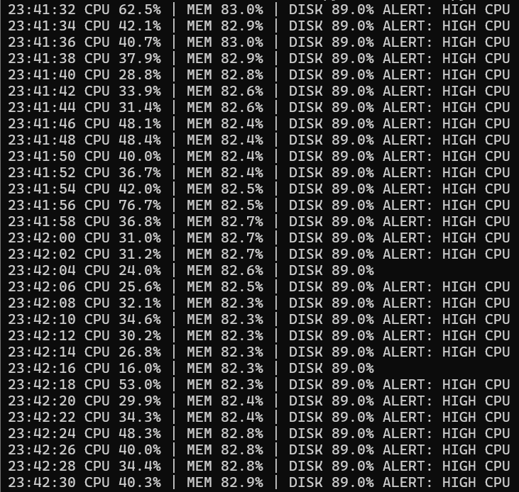
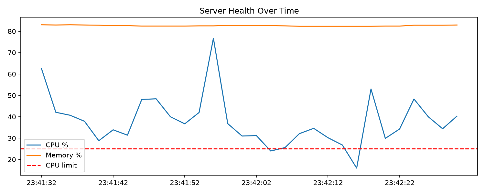

# Server Health Monitor

A Python script that samples CPU, memory, and disk usage, logs the results to CSV,
raises alerts when thresholds are crossed, and plots the trend.

## What it does
- Samples system metrics every 2 seconds using psutil
- Logs every sample to `health_log.csv`
- Prints an alert when CPU, memory, or disk usage crosses a configurable threshold
- Saves a chart of CPU and memory usage over time

## Screenshots

## How to run
pip install psutil matplotlib
python monitor.py

Thresholds are set at the top of `monitor.py`.

## Future work
- Send alerts by email or Telegram
- Monitor multiple servers and show a live dashboard

> Note: The screenshots use a low CPU threshold (10%) so alerts are easy to demonstrate. Default thresholds are 80% CPU, 85% memory, 90% disk.